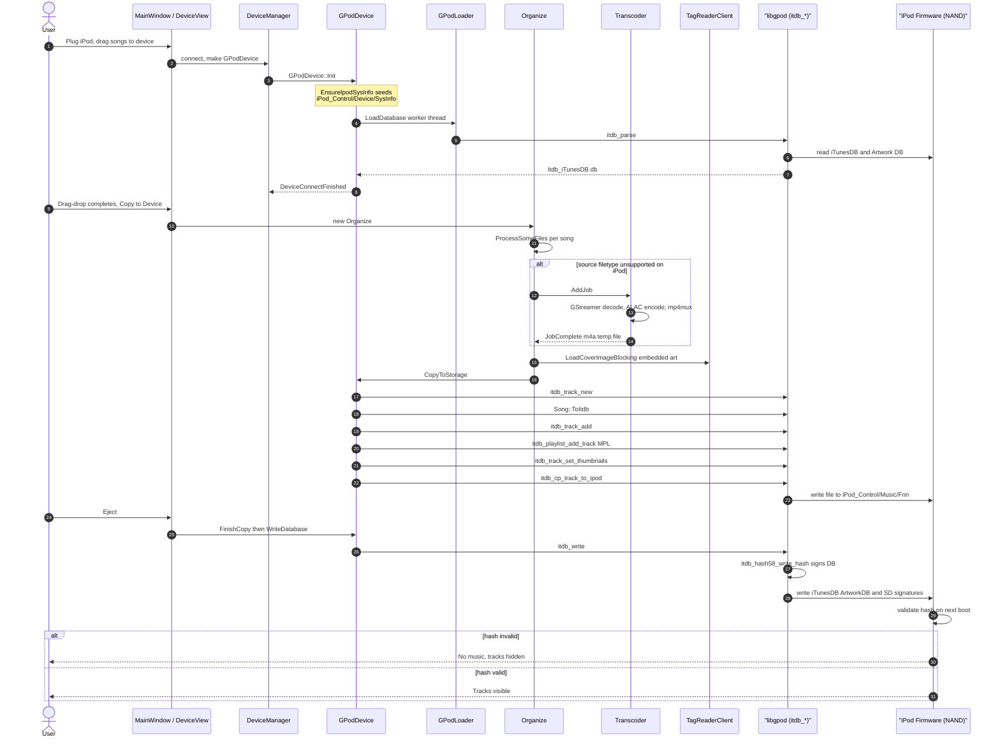

# 10. iPod Sync

> Audience: anyone touching `src/device/gpod*`, `src/organize/`, `src/transcoder/`, `src/device/audiobookmerger.*` or `Song::ToItdb()`.
> iPod sync is the most fragile path in Strawberry: small omissions make the iPod silently reject the database.
> This file holds the **rules** and the **reference**. The full story of every bug is in [`history/ipod-bug-diary.md`](./history/ipod-bug-diary.md); only open it when a symptom from the [bug index](#1010-bug-index) comes back.

---

## 10.0 Rules (each one was learned from a bug — don't break them)

| # | Rule | Where | Learned from |
|---|------|-------|--------------|
| 1 | `Device/SysInfo` must contain `FirewireGuid` and `ModelNumStr` **before** `itdb_parse`, otherwise the iTunesDB isn't hash-signed ("No Music") and artwork capabilities aren't found. `GPodDevice::EnsureIpodSysInfo` seeds it in `Init()`. | `gpoddevice.cpp` | Bug #3, §10.3 |
| 2 | `Song::ToItdb` must set `track->filetype` (a string), or tracks are invisible in the Music menus. | `song.cpp` | §10.4 |
| 3 | The iTunesDB is written in `FinishCopy` / `FinishDelete` **even when some songs failed**; songs on disk but not in the DB are lost to the user. Upstream fixed this the same way. | `GPodDevice::FinishCopy` | Bug #5 |
| 4 | **Never** call `WriteDatabase()` (full `itdb_write`) per song. `CommitCopy` is throttled to every `kCommitEvery` (50) songs or `kCommitIntervalMs` (30 s); `FinishCopy` always flushes. | `GPodDevice::CommitCopy` | Bugs #8, #9 |
| 5 | Ship the **patched libgpod** (`.idea/strawberry-libgpod`: checked `g_try_realloc` with geometric growth, `pack_*` overflow guards). Check: `strings /Applications/strawberry.app/Contents/Frameworks/libgpod.dylib \| grep -c g_try_realloc` is non-zero. | libgpod fork | Bugs #4, #11 |
| 6 | After rebuilding libgpod, or after refreshing the deps tarball (which overwrites it with the stock build), **rebuild libgpod against the current `/opt` deps and copy it to `/opt/strawberry_macos_<arch>_release/lib/libgpod.dylib`**. The install script only compares the bundle against `/opt`. | [`11-macos-dev-loop.md §11.7`](./11-macos-dev-loop.md#117-the-libgpod-fork) | Bug #12 |
| 7 | `WriteDatabase` calls `malloc_zone_pressure_relief` (macOS) / `malloc_trim` (glibc) before `itdb_write`. Keep it. | `GPodDevice::WriteDatabase` | Bug #11 |
| 8 | Remove a track from the DB with `GPodDevice::RemoveTrackFromITunesDb` (scrubs every playlist, drops the cover fingerprint, then frees). Never a bare `itdb_track_remove`: it leaves dangling pointers in playlists and crashes the next `itdb_write`. Upstream fixed this the same way. | `gpoddevice.cpp` | Bug #14 |
| 9 | Transcoder output paths are **reserved** from `GetFile()` until `ReleaseOutput()`, so same-named songs in one batch don't race for one file. Build paths with one multi-arg `.arg(a, b, c, d)`, never chained `.arg()` (a `%1` in a filename gets substituted). | `Transcoder::GetFile` | Bug #13, upstream 4a0c7c06f |
| 10 | Retry scheduling must not block the head of the queue: `ProcessSomeFiles` picks the first *due* task, backoff 2 s → 5 min cap, 10 attempts. | `Organize::ProcessSomeFiles` | Bug #13 |
| 11 | **One `Organize` per destination at a time, started only by `OrganizeQueue`.** Never `new Organize(...)->Start()` elsewhere. `GPodDevice::db_busy_` is only a backstop; a second Organize would block its thread on it. Eject is done by the queue after the device's last job. | [`12-sync-queue.md`](./12-sync-queue.md) | — |
| 12 | Report full source paths (`url().toLocalFile()`), not basenames, in `files_with_errors_`. | `Organize` | Bug #7 |
| 13 | Don't drop the `[cover-trace]` logging until cover misattribution is proven gone; it is how §10.15 of the diary is investigated. | `organize.cpp`, `gpoddevice.cpp` | Bug #9 follow-up |

### Upstream overlap (found when rebasing onto upstream 1.2.31, 2026-10)

Upstream fixed two of our bugs independently, their versions were kept:
- Bug #5 → upstream `6ca0c9698` "GPodDevice: Write the database when some files failed and remove originals after".
- Bug #14 → upstream `37a73e802` "GPodDevice: Remove the track from the playlists when copying fails" (`RemoveTrackFromITunesDb`, which also handles a track listed twice in a playlist).
Upstream also made organized filenames unique case-insensitively (`Organize::UniqueFilenames`), complementary to rule 9.

---

## 10.0a Media types: music, podcasts, audiobooks

`MusicStorage::DeviceMediaType` (`src/core/musicstorage.h`) is picked in the Organize dialog ("Copy to device as") and carried on every `CopyJob`; `GPodDevice::CopyToStorage` re-flags the track:

- **Music** — default, unchanged behaviour.
- **Podcast** — `mediatype = ITDB_MEDIATYPE_PODCAST`, added to the special Podcasts playlist (created if missing). The firmware groups episodes by `podcastrss`, so every episode of a show gets the same feed URL: the one the user typed in `PodcastDetailsDialog`, or a synthetic `strawberry://podcast/<hash of show title>`. Also sets `skip_when_shuffling`, `remember_playback_position`, `mark_unplayed = 2`; show title → album, author → artist/albumartist.
- **Audiobook** — the firmware shows one entry per (album, albumartist) and only one title per group, so a book ripped as N files would show as N one-chapter books. With `Audiobook/merge_enabled` (default on, `src/constants/audiobooksettings.h`), `AudiobookMerger` concatenates each book's files with **ffmpeg** (found on PATH, `/opt/homebrew/bin`, `/usr/local/bin`) into one `.m4b` in the cache dir (stream copy when every input is AAC/ALAC in MP4, else AAC at `aac_bitrate`, 256k). The chapter markers are written into the iTunesDB with `itdb_chapterdata_*`; the iPod ignores the QuickTime chapter track in the file. Merging runs in the sync queue's **Preparing** phase on a worker thread (see [`12-sync-queue.md`](./12-sync-queue.md)).

iPod playlists can be managed from the device context menu, "Manage iPod playlists…" (`GPodPlaylistManager` + `GPodPlaylistsDialog`). The manager never calls `itdb_write` itself; `GPodDevice::WritePlaylistChanges()` takes `db_busy_` and goes through `WriteDatabase()`.

---

## 10.1 End-to-End Data Flow



The fragile bits are steps **3** (SysInfo seeding), **15** (`Song::ToItdb` setting `filetype` correctly), and **20** (`itdb_write` actually being able to sign the DB).

## 10.2 The libgpod Mental Model

`libgpod` (in [`.idea/strawberry-libgpod/`](../.idea/strawberry-libgpod/) — a git
submodule pinned to Strawberry's fork) abstracts the binary iTunesDB. The shape
to keep in your head:

```
Itdb_iTunesDB
├── Itdb_Device          ← seeded from iPod_Control/Device/SysInfo*
│   ├── FirewireGuid     ← required for hash signing
│   ├── ModelNumStr      ← maps to Itdb_IpodInfo → ipod_generation
│   └── ArtworkCapabilities (looked up by ipod_generation)
├── tracks: GList<Itdb_Track*>
│   ├── ipod_path        ← :-separated, e.g. ":iPod_Control:Music:F00:abcd.m4a"
│   ├── filetype         ← human-readable codec string (see §10.4)
│   ├── type1, type2     ← magic bytes (see §10.4)
│   ├── mediatype = 1    ← Audio
│   ├── has_artwork
│   └── ...
└── playlists: GList<Itdb_Playlist*>
    ├── Master Playlist (MPL)   ← every track MUST also be here
    └── user playlists
```

### Useful libgpod entry points

| `itdb_*` symbol                       | What it does                                                   |
| ------------------------------------- | -------------------------------------------------------------- |
| `itdb_parse(mountpoint, &err)`        | Read iTunesDB → returns `Itdb_iTunesDB*`. Calls `EnsureIpodSysInfo` cousin internally to read `Device/SysInfo*`. |
| `itdb_write(db, &err)`                | Write iTunesDB + sign with hash. Fails silently with zero hash if SysInfo is missing FirewireGuid or ModelNumStr. |
| `itdb_track_new()`                    | Allocate a zeroed `Itdb_Track`.                                |
| `itdb_track_add(db, t, pos)`          | Insert into `db->tracks`. **Does NOT** add to MPL.             |
| `itdb_playlist_mpl(db)`               | Get the master playlist; every track must live here.           |
| `itdb_playlist_add_track(pl, t, pos)` | Adds a track to a playlist.                                    |
| `itdb_cp_track_to_ipod(t, srcpath, &err)` | Physically copies the audio file into `iPod_Control/Music/F##/` and sets `t->ipod_path`. |
| `itdb_track_set_thumbnails(t, jpg)`   | Stashes the JPEG path on the in-memory `Itdb_Track`. **Encoding is deferred** to `itdb_write` time. Returns TRUE on any sane JPEG. NB: a TRUE return does **not** mean the thumbnail will reach the iPod — the real encoding happens later in `ithumb-writer.c`'s `pack_*` functions, which can silently fail (see §10.5 known failure modes). |
| `itdb_device_get_ipod_info(device)`   | Look up the `Itdb_IpodInfo` by `ModelNumStr`. Returns the "Invalid" entry if not found. For `MC297` → `CLASSIC_3` (the lookup strips the leading region letter, so `MC297` → `C297` keys the table). |
| `itdb_device_get_artwork_capabilities(device)` | Returns NULL when `ipod_generation == UNKNOWN`. With a correct `MC297` SysInfo (Bug #3 fix) this returns the Classic-3 `ipod_classic_1_cover_art_info[]` formats — 56×56, 128×128 ×2, 320×320. |
| `itdb_device_get_checksum_type(device)` | Returns `ITDB_CHECKSUM_HASH58`/`HASH72`/`HASHAB`/`NONE` based on generation. |

## 10.3 The SysInfo File — Why It's Mandatory

When Apple's iTunes/Music.app first connects to an iPod, it writes
`iPod_Control/Device/SysInfoExtended` (a long XML plist) and
`iPod_Control/Device/SysInfo` (key: value, two-line). libgpod consults these
files on every `itdb_parse`/`itdb_write` to find out:

1. **`FirewireGuid: 0x<16hex>`** — the per-device 64-bit GUID. Used as the
   secret salt for the HMAC over the iTunesDB body. If absent or invalid,
   `itdb_device_get_hex_uuid()` returns FALSE, `itdb_hash58_write_hash()`
   silently writes zeroes into the hash field, and the iPod firmware
   **rejects every track** with no error reported back over USB.
2. **`ModelNumStr: <id>`** (e.g. `MC297` for iPod Classic 7G 160GB Black) —
   indexes into libgpod's static `ipod_info_table` to determine:
   - `ipod_generation` (controls checksum scheme, cover-art sizes).
   - Cover-art format list (sizes & pixel formats supported).
   - Default disk geometry (rarely matters).

### What Strawberry does

`GPodDevice::Init()` calls a static `EnsureIpodSysInfo(mount, unique_id)` (in
[`src/device/gpoddevice.cpp`](../src/device/gpoddevice.cpp)) **before** kicking
off `GPodLoader::LoadDatabase`. It:

- No-ops if `SysInfoExtended` exists (Apple already populated everything).
- No-ops if `SysInfo` exists *and* already contains `FirewireGuid`.
- Otherwise, derives the FirewireGuid from `unique_id` (on macOS the listener
  produces `"USB/<serial>"`, where `<serial>` *is* the FirewireGuid for all
  post-FireWire iPods), and writes:

  ```
  ModelNumStr: MC297
  FirewireGuid: 0x<UPPERCASE_SERIAL>
  ```

#### Why `MC297` specifically?

It's the iPod Classic 7G 160GB Black. We hardcode it because:

- All Classic 6G/7G and Nano 3G/4G use `ITDB_CHECKSUM_HASH58` (matches MC297).
- HASH58 is the *only* checksum scheme libgpod can compute without a host-side
  `HashInfo` file extracted from iTunes/Music.app.
- Newer devices (Nano 5G+, Touch, iPhone, iPad) use `HASH72`/`HASHAB`, which
  *cannot* work without iTunes-side initialization regardless of model string.

The hash is keyed on FirewireGuid + SHA1, **not** on the model, so MC297 is a
correct hash for any HASH58 device even though the displayed model name on the
iPod's settings screen will be wrong.

#### Diagnosing SysInfo problems

```bash
# After plugging in the iPod (mount visible at /Volumes/iPod):
cat /Volumes/iPod/iPod_Control/Device/SysInfo
# Should show ModelNumStr and FirewireGuid lines.

ls -la /Volumes/iPod/iPod_Control/iTunes/iTunesDB
# Size should be > 0; if it's exactly 0 the parse failed.

# Probe the hash header (offset 0x58 = "hash58" field, all zeroes ⇒ unsigned):
hexdump -C /Volumes/iPod/iPod_Control/iTunes/iTunesDB | grep -A1 "^00000058"
```

## 10.4 `Song::ToItdb()` — Why `filetype` String Matters

[`src/core/song.cpp`](../src/core/song.cpp) maps Strawberry's `Song` value to
an `Itdb_Track`. The non-obvious requirement: `track->filetype` **must** be a
specific human-readable English string that libgpod's
`itdb_track_set_defaults()` keys off. Without it, the iPod firmware
silently hides the track from the Music menu (the file *is* on disk, the entry
*is* in iTunesDB, but the menu shows "No Songs").

The required strings (case-sensitive, do not localize):

| Strawberry `FileType` | `track->filetype`             | `type1` | `type2` |
| --------------------- | ----------------------------- | ------- | ------- |
| `MPEG` (MP3)          | `"MPEG audio file"`           | `1`     | `1`     |
| `MP4` (AAC)           | `"AAC audio file"`            | `0`     | `0`     |
| `ALAC`                | `"Apple Lossless audio file"` | `0`     | `0`     |
| `WAV`                 | `"WAV audio file"`            | `0`     | `0`     |
| `AIFF`                | `"AIFF audio file"`           | `0`     | `0`     |
| `FLAC`                | `"FLAC audio file"`           | `0`     | `0`     |

`type1`/`type2` are documented in libgpod's `itdb.h` as "0x01 for VBR MP3, 0x00
for AAC". For practical purposes they only matter for MPEG; the rest can stay
zero.

`mediatype = 1` (Audio) is required; without it the track is treated as a
Podcast/Audiobook depending on default flags.

## 10.5 The Cover-Art Path

> ✅ As of Bug #4 (the libgpod `(gint)G_MAXUINT` overflow-guard regression
> in `ithumb-writer.c`) being fixed, the cover-art end-to-end **works**
> for FLAC sources with embedded `METADATA_BLOCK_PICTURE` art on an iPod
> Classic Gen-3 (`MC297`). Verified end-to-end against the live device:
> after a sync, `iPod_Control/Artwork/` contains the four expected
> Classic-3 `.ithmb` blobs (`F1055_1.ithmb`, `F1060_1.ithmb`,
> `F1061_1.ithmb`, `F1068_1.ithmb`) plus a populated `ArtworkDB`, and
> covers appear on the iPod's Music → Albums screen.

The chain (in order of execution):

1. `Organize::ProcessSomeFiles` builds a `MusicStorage::CopyJob` and resolves
   the cover in this order:
   - `song.art_manual` (if set, local file exists)
   - `song.art_automatic` (sidecar `cover.jpg`/`folder.jpg` discovered by
     `collectionwatcher`)
   - **For Device destinations only**: embedded art via
     `TagReaderClient::LoadCoverImageBlocking` (reads APIC frame from MP3 /
     `<picture>` block from FLAC).
2. The job is handed to `GPodDevice::CopyToStorage`.
3. If `job.cover_image_` is non-null it's saved to a temp JPEG and passed to
   `itdb_track_set_thumbnails(track, path)`.
4. `itdb_track_set_thumbnails` only **stashes the JPEG path** on
   `track->artwork->thumbnail` (as a `ITDB_THUMB_TYPE_FILE` blob) and sets
   `track->has_artwork = 1`. **No image data is read yet.** Returns TRUE on any
   sane filename — a TRUE return is *not* a signal that the cover will actually
   land on the iPod.
5. On `itdb_write` → `itdb_write_ithumb_files` (in
   `.idea/strawberry-libgpod/src/ithumb-writer.c`):
   - `itdb_device_get_cover_art_formats` is consulted (returns the
     Classic-3 `ipod_classic_1_cover_art_info[]` formats for `MC297`).
   - For each format, the deferred JPEG is re-loaded, decoded via
     `gdk-pixbuf`, scaled to the format's `width`×`height`, and packed
     into the format's pixel layout by one of the `pack_RGB_565` /
     `pack_RGB_555` / `pack_RGB_888` / `pack_I420` / `pack_UYVY`
     functions.
   - Packed pixels are appended to the per-format `F<id>_<n>.ithmb` blob
     file under `iPod_Control/Artwork/`.
   - The `ArtworkDB` index file is then written from the in-memory
     `Itdb_Artwork` structs.

### Known failure modes

- **`Artwork/` directory empty after sync (`.ithmb` files missing, `ArtworkDB`
  is a 3,320-byte empty skeleton)** — was Bug #4, fixed in
  `.idea/strawberry-libgpod/src/ithumb-writer.c`. Every `pack_*` function had
  a broken overflow guard of the form
  `g_return_val_if_fail (dest_width < (gint)G_MAXUINT/2, NULL);`. Because
  `(gint)G_MAXUINT == -1` and `-1/2 == 0`, the predicate `dest_width < 0` was
  always false → every thumbnail encode silently returned `NULL` →
  `ithumb-writer` produced zero `.ithmb` blobs → `ArtworkDB` was written but
  empty. `itdb_write` reported success at the top level because
  `g_return_val_if_fail` swallows the per-thumbnail failure, and audio
  playback was unaffected because hash58 signing is independent of artwork.
  All 10 occurrences of the pattern (across `pack_RGB_565`, `pack_RGB_555`,
  `pack_RGB_888`, `derange_pixels`, `pack_I420`, `pack_UYVY`) were rewritten
  as `(guint)X < G_MAXUINT/...` so the unsigned arithmetic makes sense.
  **Symptom signature:** during `itdb_write` libgpod emits one
  `CRITICAL: pack_*: assertion '... < (gint)G_MAXUINT/...' failed`
  per cover-art format (4× for Classic-3). If you see those criticals come
  back, the patch has regressed — re-check `ithumb-writer.c`.
- **Cover art on the iPod's "Now Playing" screen but not in album list**:
  expected behaviour on Classic/Nano. Album-list art is built from the
  *album*-level artwork blob, which is keyed off `(albumartist, album)`; if
  metadata differs between tracks of the same album the iPod treats them as
  separate albums and each one only gets art from one track.

### Diagnosing a future regression

If `.ithmb` files stop appearing after sync, the fastest reproducer is to
write a ~150-line standalone C probe that links against the same
`libgpod.dylib` Strawberry uses, parses a local FLAC's
`METADATA_BLOCK_PICTURE` directly, calls `itdb_parse` on a *clone* of the
iPod control tree (never the live mount), then `itdb_track_set_thumbnails`
+ `itdb_write`, and `ls`es the sandbox `Artwork/` directory. Any silent
encoding failure shows up as `CRITICAL: pack_*: assertion …` on stderr.
This is how Bug #4 was found — the high-level `set_thumbnails` /
`has_artwork` flags all reported success, so source-level instrumentation
of `Organize.cpp` / `LoadEmbeddedCover` / `CopyToStorage` was a dead end.

### Plumbing reference

| File                                              | Symbol                              | Notes                                                                |
| ------------------------------------------------- | ----------------------------------- | -------------------------------------------------------------------- |
| `src/organize/organize.cpp`                       | `Organize::ProcessSomeFiles`        | The cover-resolution if/else chain (lines ~250–285).                 |
| `src/core/musicstorage.h`                         | `CopyJob::cover_image_`, `cover_source_` | Either a `QImage` or a path on disk. Mutually exclusive — set one. |
| `src/tagreader/tagreaderclient.cpp`               | `LoadCoverImageBlocking`            | Sync wrapper around the out-of-process tag reader.                   |
| `src/tagreader/tagreaderbase.cpp`                 | `LoadEmbeddedCover`                 | Per-format embedded-art extractor (MP3 APIC, FLAC `<picture>`, etc.). |
| `src/device/gpoddevice.cpp`                       | `CopyToStorage`                     | Saves temp JPEG, calls `itdb_track_set_thumbnails`.                  |
| `.idea/strawberry-libgpod/src/itdb_device.c`      | `itdb_device_get_artwork_capabilities` | Picks the per-generation `Itdb_ArtworkFormat[]` from `ipod_artwork_capabilities[]`. Returns NULL only if `ipod_generation == UNKNOWN` (which happens when `ModelNumStr` is missing — see Bug #3). For `MC297` it returns the Classic-3 formats. |
| `.idea/strawberry-libgpod/src/itdb_artwork.c`     | `itdb_artwork_set_thumbnail`        | Stores the JPEG path as a `ITDB_THUMB_TYPE_FILE` thumb. No decode happens here. |
| `.idea/strawberry-libgpod/src/ithumb-writer.c`    | `itdb_write_ithumb_files`, `pack_*` | The **actual encoder**: runs at `itdb_write` time, decodes the deferred JPEG, scales, packs into per-format pixel layout, appends to `F<id>_<n>.ithmb`. Was the site of Bug #4. |

## 10.6 Transcoding for iPod (FLAC → ALAC)

iPod Classic cannot play FLAC. Strawberry's `Organize` detects this via
`MusicStorage::GetSupportedFiletypes()` (which `GPodDevice` returns as `MP4,
MPEG, ALAC`) and transcodes on the fly through GStreamer:

```
filesrc → decodebin → audioconvert → audioresample → alacenc → mp4mux → filesink
                                                       ↑
                                                       picked by
                                                       Transcoder::CreateElementForMimeType
```

### The `avenc_alac` vs `avenc_alac_at` problem

On macOS the GStreamer registry contains *two* ALAC encoders:

- `avenc_alac` — the cross-platform FFmpeg implementation (good).
- `avenc_alac_at` — the AudioToolbox-backed shim (bad).

The `_at` variants on macOS **do not propagate EOS through the pipeline**.
Symptom: transcoding progress hits 100% and hangs there forever — `mp4mux`
never finalizes the file, so `FileTranscoded` is never emitted.

`src/transcoder/transcoder.cpp` was patched so `SuitableElement::operator<`
has a tiebreaker preferring non-`_at` encoders when ranks are equal, AND
`CreateElementForMimeType` only demotes libav fallbacks to rank `-1` when a
native (non-libav) candidate exists. That way `avenc_alac` (the only ALAC
encoder on macOS) stays selectable even though libav-class candidates would
normally be deprioritized.

If transcoding hangs at 100%:

```bash
GST_DEBUG=3 /Applications/strawberry.app/Contents/MacOS/strawberry 2>&1 \
  | grep -E "transcoder|alac|mp4mux"
```

You should see `mp4mux` finalize (`pushing eos`, `wrote moov`). If you see
the `_at` encoder being picked, the tiebreaker regressed.

## 10.9 Reference: How to Add a New iPod Generation

If a future contributor wants to support a Nano 5G or later (which uses
HASH72), the steps are:

1. Add the model entry to `.idea/strawberry-libgpod/src/ipod-device-table.h`
   (look for `ipod_info_table[]`).
2. Implement HASH72 signing in `itdb_hash72.c` (currently a stub).
3. Update `EnsureIpodSysInfo` in `src/device/gpoddevice.cpp` to choose the
   correct ModelNumStr based on detected `usb_product_id`.
4. Add a CMake build flag if the new hash needs an external library (libxml2
   for SysInfoExtended parsing already pulled in).
5. Smoke-test: connect, observe `itdb_write` succeeds, hash header is
   non-zero, iPod boots without "No music".

## 10.10 Bug index

One line per bug; the diary section has the symptom fingerprint, root cause, fix and verification.

| Bug | Symptom | Root cause | Status | Diary |
|-----|---------|------------|--------|-------|
| #3 | `itdb_track_set_thumbnails` returns FALSE, no artwork | `SysInfo` missing `ModelNumStr` | Fixed (rule 1) | §10.3 (in this file) |
| #4 | Audio synced but `Artwork/` empty, `CRITICAL: pack_*: assertion … < (gint)G_MAXUINT/…` | Signed-int overflow guard in libgpod `ithumb-writer.c` | Fixed in libgpod fork | §10.5 (in this file) |
| #5 | iPod says "0 songs" / "No Music" but `Music/F*` is full; iTunesDB ~16 KB | `FinishCopy(false)` skipped `WriteDatabase` after any failure | Fixed (upstream's fix kept) | §10.8 |
| #6 | Transcoded ALAC files carry no tags | Transcoder pipeline doesn't inject tags into mp4mux | **Open** (iTunesDB has the tags, so usually invisible) | §10.8 "Related" |
| #7 | Error dialog lists only `04 Time.flac` × N | Basename instead of full path | Fixed (rule 12) | §10.10 |
| #8 | SIGSEGV around song ~1,888 in `write_mhsd_playlists`, `.ips` says `mach_vm_allocate_kernel failed` | `WriteDatabase` after every song exhausted VM | Fixed (rule 4) | §10.12 |
| #9 | ~20% of albums show the wrong cover | Same as #8, plus #14 | Mostly fixed; residual investigated with `[cover-trace]` | §10.12, §10.15 |
| #10 | Crashes leave no Strawberry-side log | — | Fixed: `CrashReporter`, `~/Library/Logs/Strawberry/strawberry-crash-<ISO>-<pid>.log`, pruned after 180 days | §10.13 |
| #11 | Same crash as #8 after the #8 fix, frame 2 `0x0` | libgpod `wcontents_maybe_expand` unchecked `g_realloc` | Fixed (rules 5, 7) | §10.14 |
| #12 | libgpod fix "deployed" but crash persists, `strings … \| grep g_try_realloc` empty | Install audit compares against stale `/opt` copy | Workaround (rule 6) | §10.14 "Deployment gotcha" |
| #13 | Sync stalls after N songs, endless "attempt 9 of 10" on a same-basename file | Transcoder output path collision + head-of-line retry blocking | Fixed (rules 9, 10) | §10.16 |
| #14 | `prepare_itdb_for_write: assertion 'link' failed` then SIGABRT after a failed copy | Bare `itdb_track_remove` left dangling playlist entries | Fixed (rule 8, upstream's helper kept) | §10.17 |

The old long "Common failure modes" table, with more symptom variants, is §10.7 of the diary.

---

## 10.11 Further reading

- [`docs/iPod-copy-flow.md`](../docs/iPod-copy-flow.md) — step-by-step walk through the copy flow with line references (written before the bugs above; line numbers are stale).
- libgpod fork: `.idea/strawberry-libgpod/` (not tracked by this repo; its own git history), particularly `itdb_itunesdb.c`, `itdb_artwork.c`, `ithumb-writer.c`, `itdb_device.c`, `itdb_hash58.c`.
- Tools: [`tools/`](./tools/) (`itdb-rescue.c` rebuilds an iTunesDB from the files on an iPod, `itdb-deep.c` dumps one) plus `parse_itunesdb.py` (raw iTunesDB parser, no libgpod) and `dump_ipod_audiobooks.py` (libgpod Python bindings) for inspecting a mounted iPod's database without Strawberry.
